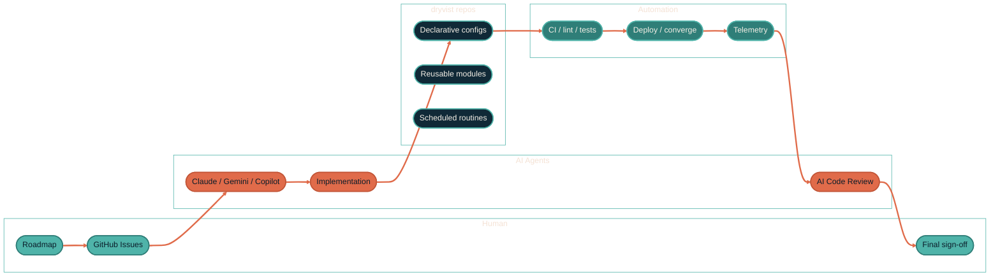

# dryvist

  

  <em>Infrastructure as code-medy: we Nix the toil and let configs do the talking.</em>

  
  
  
  

---

## What this org is

`dryvist` is the infrastructure org: humans set direction, AI agents implement,
automation runs routines, and a human signs off; configurations are declared
once, reproduced everywhere, and observable end to end.

[docs.jacobpevans.com](https://docs.jacobpevans.com) explains the architecture,
flows, decisions, and connections; the [public repo list](https://github.com/orgs/dryvist/repositories)
shows what is open to explore. Private repos exist and keep their details to
themselves.

---

## The flow

An Issue cues the agents; CI checks the changes, automation converges the
configuration, and telemetry reports back before AI reviews the PR and a
human signs off. The loop keeps its receipts.

---

## What lives here

  

  
  
  
  
  
  
  
  

### [Nix ecosystem](https://docs.jacobpevans.com/nix/overview)

Reproducible Nix configurations cover developer laptops through bare metal.

- Use `nix develop` to open a workspace with the right tools for each language and workload.
- Home Manager keeps dotfiles, shells, and command-line tools identical across macOS and Linux.
- Composable Home Manager modules install Claude Code, Gemini, Copilot, local MLX, and MCP servers; AI assistants get the same declarative treatment as neovim.
- The `nix-darwin` and NixOS configurations include AI server profiles for ROCm and CUDA workloads.
- Netboot bootstraps bare metal unattended, and we Nix the toil.

### [Infrastructure as code-medy](https://docs.jacobpevans.com/infrastructure/overview)

OpenTofu provisions VMs, networks, cloud accounts, and GitHub, while Terrakube
runs homelab workspaces. Reusable modules build golden images and manage org
governance.

- Proxmox VMs, LXC containers, networks, and firewalls use declarative configuration with safe concurrent state.
- Terrakube workspaces use native remote state and locking.
- Self-hosted GitHub Actions spot runners keep CI fast and inexpensive.
- Code manages GitHub rulesets, required workflows, and repository settings.

### [Configuration management](https://docs.jacobpevans.com/infrastructure/overview)

Terraform provisions the infrastructure, and Ansible converges it into
services; the result is playbooks, not play-by-ear.

- Proxmox roles harden hosts, tune performance, configure ZFS and swap, and set monitoring baselines.
- Application roles run observability platforms, syslog load balancers, and other long-running services.

### [AI development tooling](https://docs.jacobpevans.com/ai-development/overview)

Vendor-agnostic instructions, workflows, plugins, and scheduled routines
coordinate assistants across the portfolio.

- One framework lets Claude, Gemini, Copilot, and local models follow the same rules.
- Reusable workflows handle portfolio maintenance around the clock, including issue triage, cleanup sweeps, and multi-repo orchestration.
- Claude Code plugins, agents, skills, hooks, and slash commands support everyday development.
- Cron delivers daily portfolio briefings, PR triage, repository health scores, and automated polish.

### [Observability](https://docs.jacobpevans.com/observability/overview)

Telemetry monitors services and traces AI code, while logs have their own
supporting cast.

- Cribl Edge collectors shape data in-stream before egress from laptops, Kubernetes nodes, and homelab hosts.
- Cribl Stream workers fan data out to backends and reduce billed ingest volume.
- OpenTelemetry carries application traces, metrics, and logs, while Splunk provides indexes, HEC inputs, apps, and dashboards.
- Benchmark harnesses measure local LLM inference on Apple Silicon.

### [Templates &amp; dev tooling](https://docs.jacobpevans.com/ai-development/overview)

Templates and small utilities provide starter scaffolds for new projects.

- Project templates configure linting, formatting, type checks, pre-commit hooks, and 100% coverage gates from the start.
- Terrakube-managed OpenTofu workspace starters and Cribl Edge/Stream pack scaffolds cover new project setup.
- Workflow utilities draft issues with local AI and schedule maintenance across people, agents, and GitHub.

---

## How it fits together

The portfolio has five layers, and shared telemetry makes each one observable.

1. **Reproducibility (Nix).** Every machine starts from a Nix flake, and `nix build` is the only entry.
2. **Provisioning (Terrakube / OpenTofu).** Once a Nix-built host exists,
   workspaces allocate cloud and homelab VMs, LXC containers, cloud resources,
   and GitHub governance.
3. **Configuration (Ansible).** Idempotent roles converge provisioned hosts to their declared services.
4. **Observability (Cribl + OpenTelemetry + Splunk).** Shared pipelines shape, index, and alert on telemetry from every layer, including AI traces.
5. **AI control plane.** Multi-model assistants, workflows, and routines draft
   changes, review PRs, triage issues, maintain layers, and report through the
   same fabric.

Read the [architecture guide](https://docs.jacobpevans.com/architecture/how-it-fits-together).

---

## AI-native by default

Humans and AI agents read, edit, and review every repo together:

- **Shared instructions:** Every repo carries or inherits `AGENTS.md`, so
  Claude, Gemini, Copilot, and local models receive shared context, rules, and
  conventions.
- **Multi-model PR review:** Multiple models review every change before human approval, and the mix helps catch different bugs.
- **Scheduled routines:** Cron runs maintenance, triage, and health checks on a schedule.
- **AI telemetry:** OpenTelemetry traces and session logs record assistant activity in the shared pipeline.

The [AI development overview](https://docs.jacobpevans.com/ai-development/overview) explains the repo pattern.

---

## Read the docs first

  

**[docs.jacobpevans.com](https://docs.jacobpevans.com)** is the single, capability-organized front door.

---

## Org-wide standards

The shared configuration hub is [`dryvist/.github`](https://github.com/dryvist/.github).

| Concern | Standard |
| --- | --- |
| License | [Apache-2.0](https://www.apache.org/licenses/LICENSE-2.0), unless a repo states otherwise |
| Commits | [Conventional Commits](https://www.conventionalcommits.org) (`feat:` / `fix:` / `chore:`) drive automated releases |
| Releases | [release-please](https://github.com/googleapis/release-please): `fix:` patch, `feat:` minor, major releases human-initiated |
| Code review | Every PR gets multi-model AI review before human sign-off |
| Code lint / format | [Biome](https://biomejs.dev) for JS/TS/JSON/CSS; canonical config in [`dryvist/.github`](https://github.com/dryvist/.github) |
| Markdown lint | [markdownlint-cli2](https://github.com/DavidAnson/markdownlint-cli2) with org-wide rules |
| Workflow security | [zizmor](https://github.com/woodruffw/zizmor); org-wide policy in [`dryvist/.github`](https://github.com/dryvist/.github) |
| Dependency updates | [Renovate](https://docs.renovatebot.com) extends shared presets |
| AI assistant policy | Versioned `AGENTS.md` in every repo; org policy in [`dryvist/.github`](https://github.com/dryvist/.github) |
| CI runners | Self-hosted on AWS spot capacity; GitHub-hosted fallback for short macOS jobs |
| Security reporting | [`SECURITY.md`](https://github.com/dryvist/.github/blob/main/SECURITY.md) auto-applied to every repo's Security tab |

---

## The family

- [JacobPEvans HQ](https://github.com/JacobPEvans) — This is the front door, so commit on in.
- [Cribl](https://github.com/jpe-cribl) — Nobody gets Cribl'd on our watch.
- [Jacob's Splunk Dump](https://github.com/jpe-splunk) — It's a well-organized dump.
- [Ansible Collections](https://github.com/jpe-ansible) — It's playbooks, not play-by-ear.
- [Jacob's OpenBao Secrets Plugins](https://github.com/jpe-openbao-plugin-secrets) — Keeping secrets is our Bao-nus.
- [VCT Cribl](https://github.com/vct-cribl) — Find some Edge-ucation for your logs.
- [VCT Splunk](https://github.com/vct-splunk) — We Splunk it like it's hot.
- [JacobPEvans-personal](https://github.com/JacobPEvans-personal) — Its profile assets stay picture-perfect.

The org-wide repos sit alongside profile assets and personal one-offs on
[JacobPEvans-personal](https://github.com/JacobPEvans-personal); together, the
two accounts host the public footprint. Older repo links redirect to their
current owners.

---

  

<em>One front door. Read the docs first.</em>

